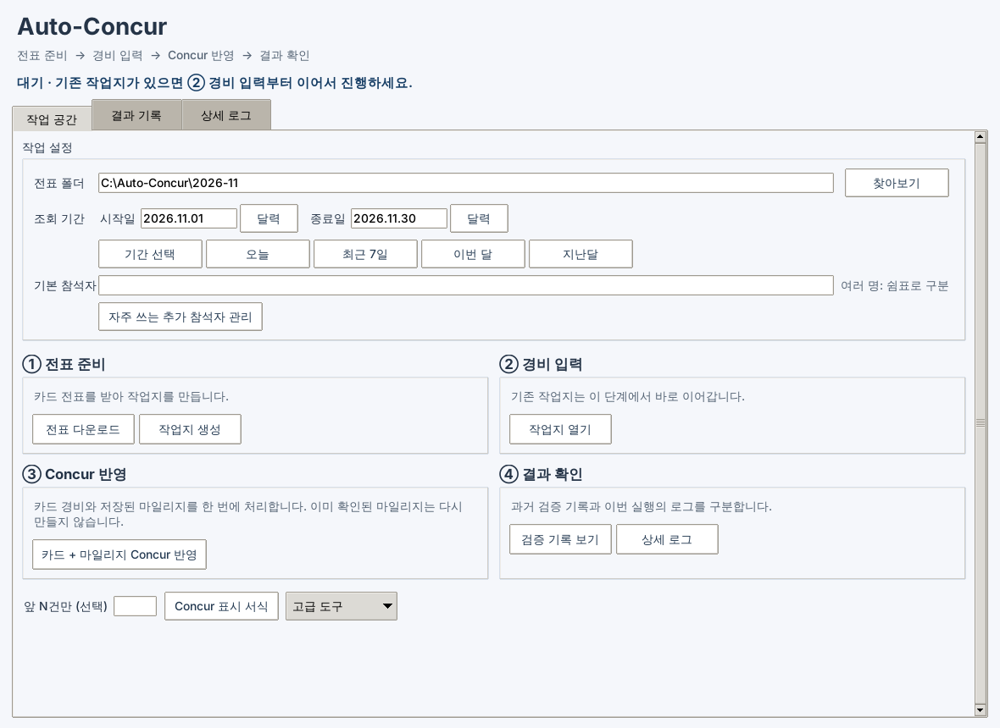
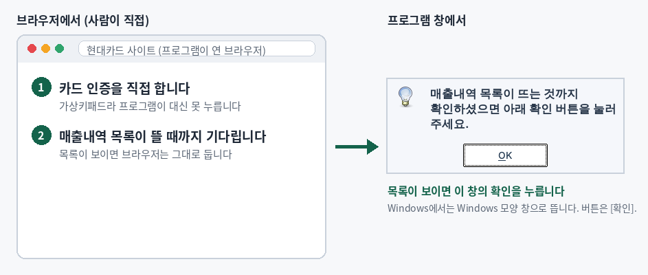
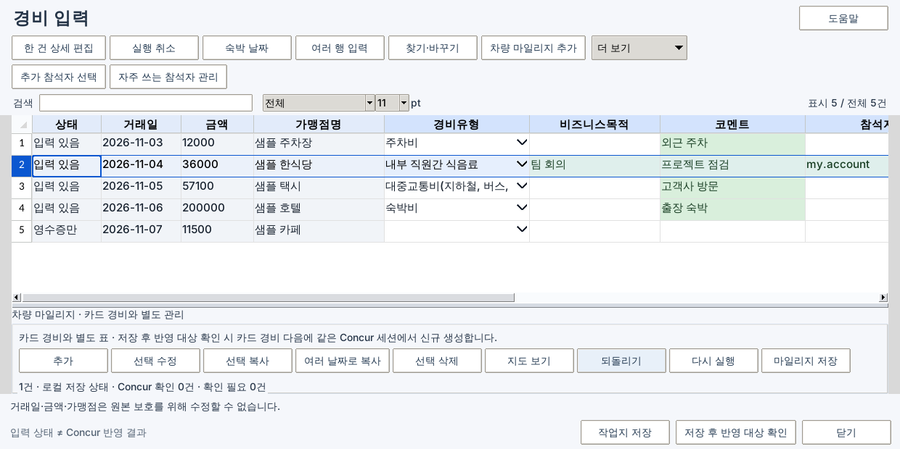
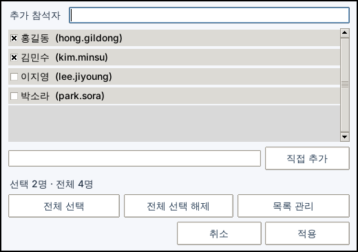
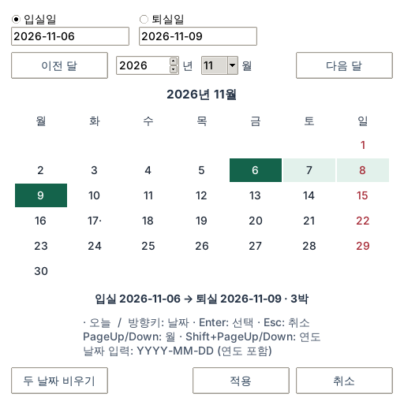
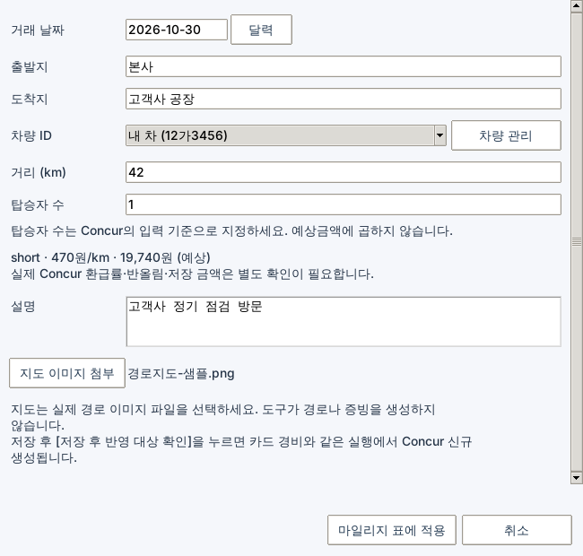
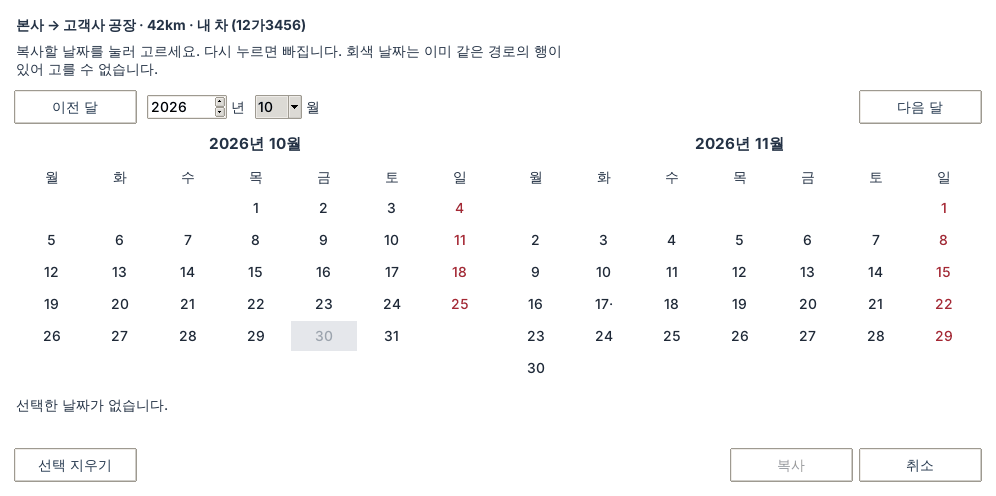
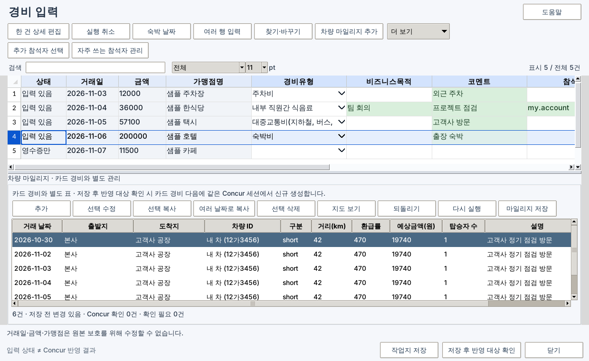
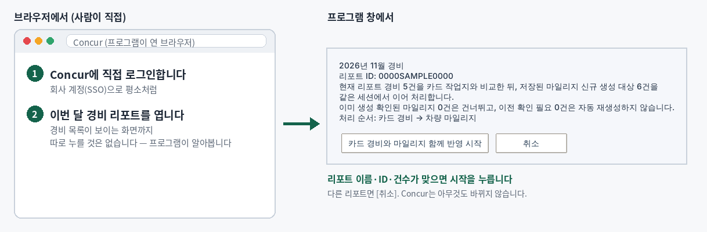
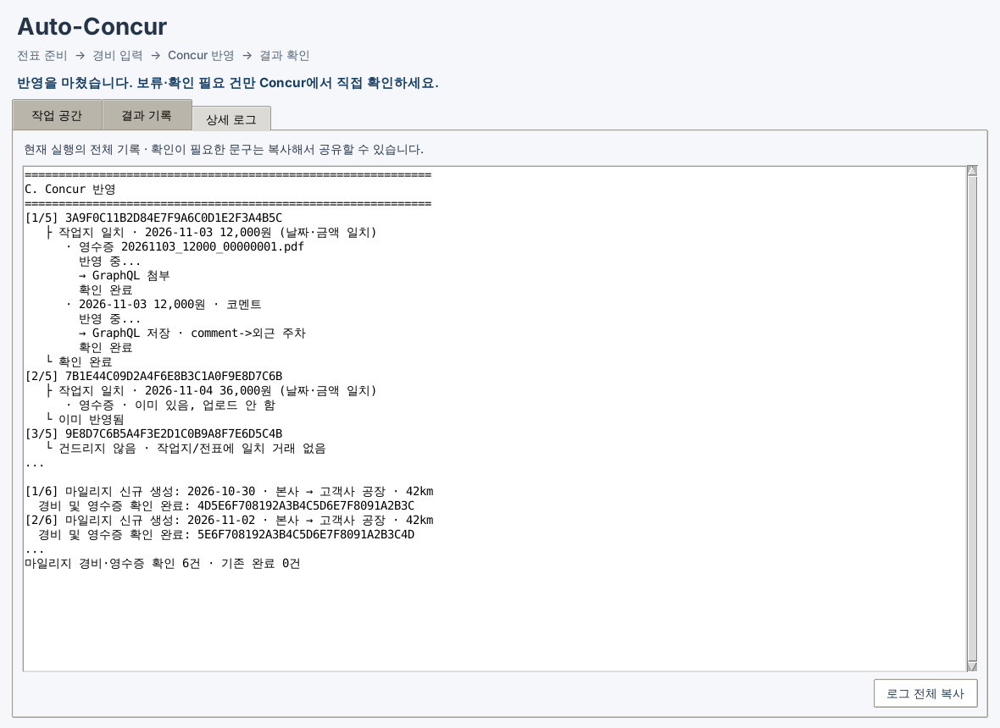

# Auto-Concur 사용 설명서

현대카드 전표를 받아서 정리하고, 프로그램 안에서 경비 내용을 적은 뒤, Concur에 한 번에 반영하는 도구입니다.
이 문서는 **매달 경비를 올리는 사람**을 위한 설명서입니다. 화면에 보이는 버튼 이름 그대로 적었습니다.

> 이 문서의 그림은 지어낸 거래(샘플 주차장·샘플 한식당 등)로 띄운 실제 프로그램 창입니다. 브라우저 쪽(현대카드·Concur)은 화면 대신 할 일을 그림으로 적었습니다.

---

## 1. 한눈에 보기

매달 하는 일은 네 단계입니다. 프로그램 첫 화면의 카드 네 장이 그대로 이 순서입니다.

| 단계 | 누르는 버튼 | 사람이 직접 하는 것 |
|---|---|---|
| ① 전표 준비 | `전표 다운로드` → `작업지 생성` | **카드 인증** (가상키패드) |
| ② 경비 입력 | `작업지 열기` | 유형·코멘트·참석자·숙박 날짜 적기 |
| ③ Concur 반영 | `카드 + 마일리지 Concur 반영` | **Concur 로그인**, 리포트 열기, 시작 확인 |
| ④ 결과 확인 | `검증 기록 보기`, `상세 로그` | 보류된 건만 Concur에서 직접 확인 |



**프로그램이 하지 않는 것**

- 카드 인증과 Concur 로그인. 항상 사람이 직접 합니다.
- **리포트 제출.** 프로그램은 경비를 채우기만 합니다. 내용을 확인하고 제출하는 것은 Concur에서 직접 하세요.
- 경비 삭제.

---

## 2. 처음 한 번: 설치

### exe 파일을 받은 경우

1. 빈 폴더를 하나 만들고 `Auto-Concur.exe`를 넣습니다. 전표와 설정이 이 폴더에 쌓입니다.
2. 실행합니다. **첫 실행 때 브라우저를 한 번 내려받습니다**(몇 분). 다음부터는 바로 열립니다.

### 소스를 받은 경우

1. `setup.bat`을 실행합니다. (Python 3.10 이상이 없으면 설치를 시도합니다.)
2. `run.bat`으로 실행합니다.

### 실행 환경

- **일반 브라우저가 인터넷에 나갈 수 있는 환경**에서 쓰세요. 브라우저 실행을 가로채는 격리 환경(예: 격리 브라우저를 거쳐야만 외부 사이트가 열리는 PC)에서는 브라우저가 떴다가 바로 닫힙니다.
- 창 아래 로그 첫 줄의 `코드 기준: 2026-11-06 20:00` 은 지금 돌고 있는 프로그램이 언제 것인지입니다. 새 버전을 받았는데 이 날짜가 그대로면 exe를 다시 받거나 다시 빌드해야 합니다.

---

## 3. 매달 하는 순서

### 3-1. 작업 설정 (첫 화면 위쪽)

- **전표 폴더**: 이번 달 전표를 둘 폴더. 비워두면 프로그램이 있는 폴더를 씁니다. 달마다 폴더를 따로 두면 섞이지 않습니다.
- **조회 기간**: `시작일`·`종료일`을 직접 적거나 달력에서 고릅니다. `이번 달`·`지난달` 버튼으로 한 번에 넣을 수 있습니다.
- **기본 참석자**: 식음료 경비에 늘 들어가는 사람(보통 본인). 여러 명은 쉼표로 구분합니다.

### 3-2. ① 전표 준비

**`전표 다운로드`**

1. 브라우저가 열리고 현대카드 화면이 뜹니다.
2. **카드 인증을 직접 합니다.** 가상키패드라 프로그램이 대신 누를 수 없습니다.
3. 인증이 끝나면 프로그램 창에 뜬 **확인 버튼**을 누릅니다.
4. 기간 안의 거래를 찾아 전표를 내려받고 한 장씩 나눕니다.



**`작업지 생성`**

전표를 읽어 `날짜_금액_승인번호.pdf`로 이름을 바꾸고 작업지를 만듭니다. 로그에 `전표 18건, 합계 365,100원을 정리했습니다`처럼 건수와 합계가 찍히니 카드 내역과 맞는지 한 번 보세요.

**사진으로 찍은 영수증이 있을 때**

`작업지 생성`을 누르기 **전에** 전표 폴더에 넣어 두면 같이 정리됩니다. 파일 이름으로 날짜와 금액을 알려줘야 합니다.

- `20261101-17000.jpg` — 2026년 11월 1일, 17,000원
- 같은 날 같은 금액이 또 있으면 `20261101-17000-2.jpg`
- jpg, jpeg, png, gif, tif, tiff를 받습니다. **HEIC(아이폰 기본 형식)는 안 됩니다** — JPG로 바꿔서 넣으세요.

> 작업지가 이미 있으면 ①을 다시 할 필요가 없습니다. ②의 `작업지 열기`부터 이어서 하세요. `작업지 생성`을 다시 눌러도 적어둔 내용은 보존됩니다.

### 3-3. ② 경비 입력

`작업지 열기`를 누르면 표가 뜹니다. 한 줄이 전표 한 장입니다.



**기본 규칙 세 가지**

1. **빈칸은 "Concur에 있는 값을 그대로 둔다"는 뜻입니다.** 지우라는 뜻이 아닙니다. 바꿀 칸만 적으면 됩니다.
2. **초록색 칸은 그 유형에서 채우면 좋은 칸**입니다. 안내일 뿐이고, 비워도 저장은 됩니다.
3. **거래일·금액·가맹점은 못 고칩니다.** 전표와 Concur 경비를 짝짓는 열쇠라서 잠가 두었습니다.

**유형별로 채울 칸**

| 경비유형 | 채울 칸 |
|---|---|
| 내부 직원간 식음료 | 비즈니스목적, 코멘트, 참석자, 추가 참석자 |
| 숙박비 | 입실날짜, 퇴실날짜, 숙박위치, Booking Channel, 코멘트 |
| 대중교통비, 주차비, 항공비, 기타 사무용품 | 코멘트 (Concur의 '설명'으로 들어갑니다) |

**참석자 적는 법**

- 계정 이름(`kyungsik.oh`)이나 **메일 주소 그대로**(`kyungsik.oh@siemens.com`) 적어도 됩니다. 주소록에서 복사해 붙이면 됩니다.
- 여러 명은 쉼표로 구분합니다: `kyungsik.oh, hong.gildong`
- **참석자**는 늘 들어가는 사람, **추가 참석자**는 그날 같이 식사한 사람입니다. 반영할 때 두 칸을 합쳐서 넣습니다.
- 추가 참석자 칸에서 더블클릭(또는 F4)하면 자주 쓰는 사람 목록에서 체크로 고를 수 있습니다. 목록은 `자주 쓰는 참석자 관리`에서 만듭니다.

  

- 두 칸이 다 비어 있으면 Concur의 기존 참석자를 건드리지 않습니다.

**숙박비 적는 법**

- 입실·퇴실 칸을 더블클릭하거나 `숙박 날짜` 버튼을 누르면 달력에서 두 날짜를 한 번에 고릅니다.

  

- 직접 적어도 됩니다: `2026-11-03`, `2026.11.3`, `20261103`, `11/3`, `11월 3일`
- 입실·퇴실은 **둘 다 적거나 둘 다 비웁니다.**
- 1박 요금은 프로그램이 나눕니다. 20만원 3박이면 66,667 / 66,667 / 66,666원으로, 합이 정확히 맞게 넣습니다.
- 숙박위치는 `국내`/`해외`, Booking Channel은 `Concur (HRS)`/`Others` 중에서 고릅니다.

**편리한 기능**

| 버튼 | 하는 일 |
|---|---|
| `여러 행 입력` | 고른 여러 줄에 같은 유형·코멘트·참석자를 한 번에 넣습니다 |
| `찾기·바꾸기` (Ctrl+H) | 찾아서 바꾸기. 모두 바꾸기도 Ctrl+Z 한 번으로 되돌립니다 |
| `한 건 상세 편집` | 한 줄을 큰 창에서 편집합니다 |
| `실행 취소` (Ctrl+Z) / Ctrl+Y | 되돌리기 / 다시 실행 |
| Ctrl+C, Ctrl+V | 칸 범위 복사·붙여넣기 |
| `더 보기` → `이전 저장 복원` | 직전에 저장한 상태로 되돌립니다 |
| `더 보기` → `가져오기`/`내보내기` | 엑셀로 내보내거나, 엑셀에서 적은 것을 가져옵니다 |

위쪽 **필터**(`숙박비`, `식음료`, `입력 있음` 등)와 **검색**은 **보이는 줄만 바꿉니다.** Concur에 반영할 때는 필터와 상관없이 작업지 전체를 봅니다.

**저장**

- `작업지 저장` (Ctrl+S): 저장만 합니다.
- `저장 후 반영 대상 확인`: 저장하고 바로 ③으로 넘어갑니다.

### 3-4. 자동차 마일리지 (해당하는 사람만)

작업지 창에서 `차량 마일리지 추가`를 누르면 카드 표 아래에 마일리지 표가 생깁니다.

**처음 한 번: 차량 등록**

입력 창의 `차량 관리`에서 차량을 등록합니다. **이름을 Concur의 '차량 ID'에 보이는 이름과 똑같이** 적어야 합니다. 한 글자라도 다르면 Concur에서 그 차를 고르지 못합니다.

**한 건 추가**

거래 날짜, 출발지, 도착지, 차량 ID, 거리(km), 탑승자 수, 설명을 적고 `지도 이미지 첨부`로 경로 지도(PNG/JPG, 20MB 이하)를 붙입니다. `마일리지 표에 적용`을 누르면 표에 들어갑니다.




- 화면의 **예상금액은 참고용**입니다. 실제 금액은 Concur가 회사 요율로 계산합니다. 프로그램은 금액을 Concur에 보내지 않습니다.

**같은 길을 여러 날 다녔을 때: `여러 날짜로 복사`**

1. 표에서 복사할 줄을 하나 고릅니다.
2. `여러 날짜로 복사`를 누르면 달력이 뜹니다.
3. 날짜를 눌러 고릅니다. 다시 누르면 빠집니다. (예: 11월 첫 주 월~금 다섯 날)
4. `5건 복사`를 누르면 날짜만 다르고 나머지는 같은 줄이 다섯 개 생깁니다. 지도도 같이 복사됩니다.






- 이미 같은 경로가 있는 날짜는 회색이고 고를 수 없습니다. 같은 날이 두 번 들어가지 않습니다.
- `되돌리기` 한 번이면 방금 복사한 줄이 전부 사라집니다.
- 한 건만 복사하면서 내용도 고치고 싶으면 `선택 복사`를 쓰세요.

**`마일리지 저장`을 꼭 누르세요.** 표에 넣은 것만으로는 파일에 남지 않습니다. 마일리지는 카드 작업지와 따로 저장됩니다.

### 3-5. ③ Concur 반영

`카드 + 마일리지 Concur 반영`(또는 작업지 창의 `저장 후 반영 대상 확인`)을 누릅니다.

1. 브라우저가 열립니다. **Concur에 직접 로그인합니다.**
2. **이번 달 경비 리포트를 열어 경비 목록이 보이게 합니다.** 프로그램이 화면을 알아서 확인하니 따로 누를 것은 없습니다.
3. 프로그램 창에 리포트 이름·리포트 ID·건수가 뜹니다. **맞는 리포트인지 확인**하고 시작 버튼을 누릅니다.

   

4. 카드 경비를 한 건씩 처리하고, 이어서 마일리지를 만듭니다.

**한 건을 처리하는 순서**

```
경비 열기 → 작업지와 짝짓기(날짜·금액) → 영수증 붙이기 → 내용 넣기 → 저장된 것 다시 확인
```

- 날짜와 금액이 작업지와 맞는 경비만 건드립니다. 리포트에 있지만 작업지에 없는 경비는 그대로 둡니다.
- 영수증이 이미 붙어 있으면 다시 올리지 않습니다.
- 애매하면 그 건만 **보류**하고 다음 건으로 갑니다. 추측해서 넣지 않습니다.

**처음 써보거나 불안할 때: `앞 N건만`**

첫 화면의 `앞 N건만 (선택)`에 `1`을 적고 돌리면 영수증 1건과 입력 1건만 처리합니다. Concur에서 결과를 눈으로 확인한 뒤, 칸을 비우고 다시 돌리면 나머지를 처리합니다. 이미 끝난 건은 건너뜁니다.

**끝난 뒤**

Concur에서 리포트를 훑어보고 **직접 제출**합니다.

---

## 4. 로그 읽는 법

③을 돌리면 경비마다 이렇게 찍힙니다.

```
[5/20] 91C63C7FAE3CCB40A40E81C55EDACB0B
   ├ 작업지 일치 · 2026-10-29 11,700원 (날짜·금액 일치)
      · 영수증 20261029_11700_00507856.pdf
        반영 중...
        → GraphQL 첨부
        확인 완료
      · 2026-10-29 11,700원 · 코멘트
        반영 중...
        → GraphQL 저장 · comment->주차비
        확인 완료
   └ 확인 완료
```

맨 왼쪽 `[5/20]`이 경비 하나이고, 들여쓴 줄이 그 경비에서 한 일입니다.

| 보이는 말 | 뜻 | 할 일 |
|---|---|---|
| `확인 완료` | 넣었고, 다시 읽어서 맞는 것까지 확인했습니다 | 없음 |
| `영수증 · 이미 있음, 업로드 안 함` | 영수증이 이미 붙어 있습니다 | 없음 |
| `이미 반영됨` | 전에 이미 처리한 건입니다 | 없음 |
| `건드리지 않음 · 작업지/전표에 일치 거래 없음` | 리포트에는 있지만 이번 작업지에는 없는 경비입니다 | 없음 (의도한 대로면) |
| `→ 화면으로 저장합니다 (…)` | 빠른 길을 못 써서 화면을 직접 눌러 처리했습니다 | 없음. 결과는 같습니다 |
| `보류 · …` / `이 경비만 보류 · …` | 확신할 수 없어서 그 건을 건드리지 않았습니다 | Concur에서 그 건을 직접 확인 |
| `결과 확인 필요 - …` | 넣기는 했는데 결과를 확인하지 못했습니다 | **Concur에서 그 건을 열어 확인** |
| `확인 필요 · 자동 재실행하지 않음` | 지난번 결과가 불확실해서 다시 보내지 않았습니다 | Concur에서 확인하고 필요하면 직접 수정 |
| `Concur 예외: …` | Concur가 그 경비에 경고를 붙였습니다 (빠진 칸 등) | 적힌 내용대로 작업지나 Concur에서 보완 |

마지막 줄이 요약입니다.

```
상세 확인 18건 · 기존 영수증 유지 9건 · 첨부 확인 8건 · 입력 확인 15건 · 보류 5건
```

**`보류`와 `확인 필요`가 0이 아니면 그 건들만 Concur에서 직접 보면 됩니다.** 다시 돌려도 안전합니다 — 끝난 건은 건너뛰고, 결과가 불확실했던 건은 자동으로 다시 보내지 않습니다.

`상세 로그` 탭의 `로그 전체 복사`로 로그를 통째로 복사할 수 있습니다. 문제가 생겨 물어볼 때 이걸 붙여 주세요.



---

## 5. 자주 겪는 일

| 증상 | 원인과 해결 |
|---|---|
| 브라우저가 떴다가 바로 닫힌다 | 브라우저 실행을 가로채는 보안·격리 환경입니다. 일반 환경에서 실행하세요 |
| 빈 창이 하나 더 뜬다 | 프로그램이 몇 초 안에 닫습니다. 남아 있으면 닫아도 됩니다 |
| 새 버전을 받았는데 그대로다 | 로그 첫 줄의 `코드 기준` 날짜를 보세요. 옛날이면 exe를 다시 받거나 빌드해야 합니다 |
| `Concur가 저장을 거부했습니다 … 경비 유형` | 그 경비에 유형이 없습니다. 작업지의 경비유형 칸을 채우고 다시 돌리세요 |
| 참석자를 못 찾는다 | 계정 이름이나 메일 주소가 맞는지 확인하세요. **한 명이라도 못 찾으면 아무도 넣지 않습니다** (일부만 넣으면 기존 참석자가 지워지기 때문입니다) |
| 마일리지에서 차량을 못 고른다 | `차량 관리`의 이름이 Concur의 차량 ID 이름과 똑같은지 확인하세요 |
| 숙박비에서 `날짜 범위` 오류 | 입실·퇴실 날짜가 둘 다 적혀 있는지 확인하세요 |
| 사진 영수증이 안 잡힌다 | 파일 이름이 `20261101-17000.jpg` 꼴인지, HEIC가 아닌지 확인하세요 |
| 목록을 못 읽고 멈춘다 | Concur에서 **경비 목록 화면**이 열려 있어야 합니다. 경비 상세나 홈 화면이면 기다리다 멈춥니다 |
| 반영 도중 창을 닫았다 | 다시 돌리면 됩니다. 끝난 건은 건너뜁니다. 닫는 순간 처리 중이던 한 건은 `확인 필요`로 남으니 Concur에서 직접 확인하세요 |

**하면 안 되는 것**

- **③을 돌리는 동안 프로그램을 하나 더 띄우지 마세요.** 브라우저를 같이 쓰기 때문에 둘 다 멈춥니다.
- 반영 중에 그 브라우저 창에서 다른 리포트로 옮겨 가지 마세요. 프로그램이 리포트가 바뀐 것을 알아채고 멈춥니다.

---

## 6. 폴더에 생기는 파일

전표 폴더 안에 저장됩니다. 직접 고칠 필요는 없습니다.

| 파일 | 내용 |
|---|---|
| `날짜_금액_승인번호.pdf`, 사진 | Concur에 붙일 영수증 |
| `workbook.json` | 작업지에 적은 내용 |
| `manifest.csv` | 전표 목록 |
| `mileage-workbook.json`, `mileage-maps/` | 마일리지 표와 지도 이미지 |
| `concur-progress.json` | 어느 건을 어디까지 처리했는지. 같은 건을 두 번 보내지 않게 하는 기록 |
| `inspect-out/` | 문제가 났을 때 남기는 진단 파일 |

프로그램 폴더에는 `settings.json`(내 설정), `browser-profile/`(로그인 상태)이 생깁니다.

> **이 파일들에는 실제 카드 거래 내역이 들어 있습니다.** 폴더째로 다른 사람에게 주거나 메신저에 올리지 마세요. 프로그램을 나눠줄 때는 exe 파일만 주면 됩니다.

---

## 7. 알아두면 좋은 것

- **자기 계정, 자기 로그인으로만 동작합니다.** 비밀번호나 인증 정보를 프로그램이 저장하지 않습니다. 로그인 상태는 내 PC의 `browser-profile/`에만 남습니다.
- Concur에 넣을 때 두 가지 길을 씁니다. 빠른 길(로그에 `→ GraphQL …`)이 안 되면 화면을 직접 누르는 길(`→ 화면으로 …`)로 넘어갑니다. 어느 쪽이든 넣은 뒤에 화면에서 다시 읽어 확인합니다.
- 빠른 길을 끄고 화면으로만 돌리고 싶으면 환경변수 `AUTO_CONCUR_NO_GRAPHQL=1`을 주고 실행합니다.
- 화면 표시 형식이 다른 계정(날짜가 `일/월/년`으로 보이는 등)은 첫 화면의 `Concur 표시 서식`에서 맞출 수 있습니다. 보통은 `자동 판단`으로 둡니다.
